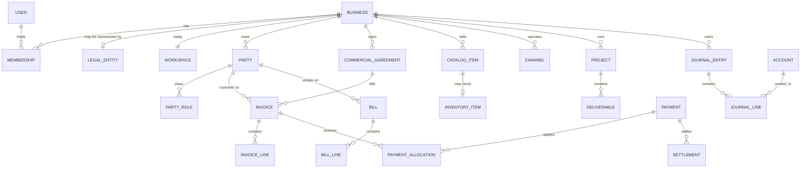

# Canonical business domain model

Status: **Milestone 2 design; no new runtime schema exists.** The only implemented
business records are `tenancy_business`, `tenancy_membership` and
`tenancy_invitation`. Everything marked *proposed* below requires a migration, tests
and an ADR amendment before it is described as implemented.

This document is the source of truth for business-level entities. The accounting
counterparts are in [FINANCIAL_DOMAIN_MODEL.md](FINANCIAL_DOMAIN_MODEL.md), the
rules in [ACCOUNTING_INVARIANTS.md](ACCOUNTING_INVARIANTS.md), and the storage
proposal in [D1_FINANCIAL_SCHEMA_DESIGN.md](D1_FINANCIAL_SCHEMA_DESIGN.md).

---

## 1. Principles

1. **One books boundary, many business shapes.** Every authoritative financial
   record belongs to exactly one `Business`. Creator, agency, retailer and service
   company differ in enabled capabilities and commercial documents, not in ledger
   mechanics.
2. **A workspace is not a legal entity.** A workspace is an access and presentation
   scope. A legal entity is an optional legal fact. Neither may be inferred from the
   other.
3. **Optional capabilities do not pollute the core.** Inventory, payroll, projects,
   campaigns and multi-entity consolidation are capabilities attached to a business,
   not columns that every business must carry.
4. **Operational records are not accounting authority.** Orders, campaigns,
   deliverables, inventory movements and approvals can request a financial
   consequence; only `financial-core` validates and records it.
5. **Tenant identity is structural.** `business_id` is part of every tenant-owned
   key and relationship, not a filter added by a query.
6. **No segment-specific ledgers.** There is no `creator_journal` or `sme_invoice`
   table. Differences are expressed through `business_type`, enabled capabilities,
   revenue-source classification and commercial agreements.

---

## 2. Core terminology

| Term | Meaning | Implemented? |
| --- | --- | --- |
| **User** | Authenticated natural person. Owns credentials, sessions and second factors. | Yes (`identity_user`) |
| **Business** | The accounting, isolation and ownership root. Has one functional currency and one set of books. This is the tenant. | Yes (`tenancy_business`) |
| **Legal entity** | Optional registered legal person (company, LLP, sole proprietorship registration). Supplies legal name, registration and tax identifiers. | No |
| **Workspace** | Access/presentation scope for operating a business. Today one implicit workspace per business. | No separate table |
| **Membership** | A user's role in a business. Roles: owner, accountant, employee, contractor, agency. | Yes (`tenancy_membership`) |
| **Business profile** | Non-legal descriptive and operational configuration: type, channels, capabilities, locale, fiscal settings. | Partial (name, currency) |
| **Channel** | A source of commercial activity (direct, YouTube, Shopify, retail location). A dimension, never an account. | No |
| **Counterparty / party** | A person or organisation Hestian does business with. Customer, vendor, contractor and employee are roles on a party, not separate identity roots. | No |
| **Catalog item** | A product, service or digital good that can be sold. Inventory is an optional extension. | No |
| **Commercial agreement** | Sponsorship, campaign, retainer or recurring contract that explains *why* invoices and payments exist. | No |
| **Operational document** | Order, purchase order, deliverable, approval, project or inventory movement. It has no debit or credit. | No |
| **Source evidence** | Imported statement, provider record, receipt or uploaded document. Immutable, but not accounting. | No |
| **Financial event** | A validated business fact that may be posted. Carries idempotency and provenance. | No |

`TenantId` and `BusinessId` in code currently mean the same thing. Keep both names
until the tenancy module exposes a compatibility alias; do not introduce a second
tenant concept in storage.

---

## 3. Context map

```
                         ┌──────────────────────────────┐
                         │ User (identity)              │
                         │ credentials · sessions · MFA │
                         └──────────────┬───────────────┘
                                        │ membership (role)
                         ┌──────────────▼───────────────┐
                         │ Business (tenant, books)     │
                         │ functional currency · basis  │
                         │ fiscal calendar · capabilities│
                         └───┬───────────┬───────────┬──┘
                             │           │           │
              ┌──────────────▼──┐  ┌─────▼──────┐  ┌─▼─────────────────┐
              │ Legal entity    │  │ Workspace  │  │ Business profile  │
              │ optional        │  │ 1:1 today  │  │ type · channels   │
              └─────────────────┘  └─────┬──────┘  └───────────────────┘
                                         │
        ┌────────────────────────────────┼────────────────────────────────┐
        │                                │                                │
┌───────▼────────┐              ┌────────▼────────┐              ┌────────▼────────┐
│ Parties        │              │ Commercial      │              │ Operations      │
│ customer ·     │              │ agreements      │              │ projects ·      │
│ vendor ·       │              │ sponsorship ·   │              │ orders ·        │
│ contractor ·   │              │ retainer ·      │              │ inventory ·     │
│ employee       │              │ campaign        │              │ approvals       │
└───────┬────────┘              └────────┬────────┘              └────────┬────────┘
        │                                │                                │
        └──────────────┬─────────────────┴────────────────┬───────────────┘
                       │                                  │
              ┌────────▼────────┐                ┌────────▼────────┐
              │ Financial event │───validated───►│ Journal / documents│
              │ idempotent      │                │ financial-core     │
              └─────────────────┘                └───────────────────┘
```

The arrows into `Financial event` are **requests**. They do not become accounting
until `financial-core` validates provenance, period state, balance and authorization.

---

## 4. Entity catalogue

Legend: **U** = universal (every business needs the concept), **O** = optional
capability. "Core" means canonical business/financial foundation; "capability" means
it can be enabled per business without changing the ledger.

| Entity | Represents | U/O | Owner / tenant boundary | Lifecycle | Core or capability |
| --- | --- | --- | --- | --- | --- |
| Business | Accounting and isolation root | U | `tenancy`; `id` is tenant id | `active → archived` (never hard-deleted while books exist) | Core |
| Business profile | Operational configuration: type, locale, fiscal start, basis, channels, capabilities | U | `tenancy`; `business_id` | Versioned changes, audited | Core |
| Business type | Creator, service, retail, ecommerce, digital, trading, hybrid | U | `tenancy`; enum or reference | Changed with recorded reason; never changes historical classification | Core classification |
| Legal structure | Sole trader, partnership, LLP, corporation, nonprofit, other | O | `tenancy`; `business_id` | Draft → confirmed; effective-dated | Capability |
| Legal entity | Registered legal person with registration/tax IDs | O | `tenancy`; `business_id`, optional `legal_entity_id` | Draft → active → dissolved; effective-dated | Core extension |
| Workspace | Access/presentation scope | U (implicit today) | `tenancy`; `business_id` | Active → archived | Core shell |
| Membership | User role in a business | U | `tenancy`; `(business_id,user_id)` unique | Invited → active → suspended/removed; last-owner invariant | Core |
| Role / permission | Ceiling and grants | U | `tenancy`; role is global vocabulary, grant is business-scoped | Role fixed; grants effective-dated | Core |
| Business location | Physical or operating location | O | `tenancy`; `business_id` | Active → closed; address history retained | Capability |
| Channel | Commercial source/location dimension | O | `tenancy`; `business_id` | Active → inactive | Capability |
| Counterparty | Person/organisation | U | `tenancy`; `business_id` | Active → archived; never hard-deleted if referenced | Core |
| Customer role | Party that buys | O per party | `tenancy`; `(business_id,party_id)` | Active → inactive; credit terms versioned | Core role |
| Vendor role | Party that supplies | O per party | `tenancy`; `(business_id,party_id)` | Active → inactive | Core role |
| Contractor engagement | Party engaged for work | O | `business-operations`; `business_id` | Draft → active → ended | Capability |
| Employee record | Employment relationship | O | `business-operations`; `business_id` | Pending → active → ended | Capability (payroll deferred) |
| Catalog item | Product, service or digital good | O | `business-operations`/`financial-core` boundary; `business_id` | Draft → active → archived | Capability |
| Inventory item | Stock-keeping extension of a catalog item | O | `business-operations`; `business_id` | Active → discontinued | Capability |
| External platform | Provider descriptor and business connection (YouTube, Shopify, etc.) | O | `integrations`; `business_id` | Pending → connected → revoked | Capability |
| Payment provider | Provider descriptor and business account | O | `integrations`; `business_id` | Pending → connected → revoked | Capability |
| Commercial agreement | Sponsorship, campaign, retainer or recurring contract | O | `business-operations`; `business_id` | Draft → active → completed/terminated | Capability |
| Project / campaign | Delivery or marketing container | O | `business-operations` / `growth`; `business_id` | Planned → active → closed | Capability |
| Sales order | Customer commitment before invoicing | O | `business-operations`; `business_id` | Draft → confirmed → fulfilled/cancelled | Capability |
| Purchase order | Supplier commitment before billing | O | `business-operations`; `business_id` | Draft → approved → received/cancelled | Capability |
| Inventory movement | Receipt, issue, adjustment, transfer | O | `business-operations`; `business_id` | Posted movement; correction by reversal | Capability |
| Recurring contract | Subscription/retainer billing schedule | O | `business-operations`; `business_id` | Draft → active → ended | Capability |

### 4.1 Business, legal entity and workspace

- **Business** is the books boundary. It owns the functional currency, accounting
  basis, fiscal calendar and chart of accounts. A business may be a sole trader with
  no registered company, a creator with no employees, or a retailer with inventory.
- **LegalEntity** is optional and effective-dated. It answers "which legal person is
  liable / which tax registration applies", not "which books are these". One legal
  entity may later own several businesses; that is a consolidation concern, not a
  reason to merge their ledgers.
- **Workspace** is the UI and access container. Today it is 1:1 with a business and
  has no row of its own. A future workspace may show several businesses to a user,
  but every financial query still carries one `business_id`. Cross-business
  consolidation is deferred and must never become implicit aggregation.
- **Business type** selects defaults and optional navigation, not accounting rules.
  Switching `creator → ecommerce` must not rewrite accounts or posted entries.
- **Accounting basis** (`accrual` or `cash`) and **functional currency** are explicit
  configuration. They become immutable for a business once a posted entry exists;
  later changes require a new policy version and prospective treatment.

### 4.2 Parties rather than four disconnected address books

Customer, vendor, contractor and employee are **roles** played by a party. A brand
can be both a customer and a vendor; a freelancer can be a contractor and a customer.
One party record prevents duplicate identities and makes counterparty history
coherent. Role-specific data lives in extensions:

- customer: credit terms, tax status, billing preferences;
- vendor: remittance details, default expense account, payment terms;
- contractor: engagement, rate, withholding (deferred);
- employee: employment record, cost centre (payroll deferred).

A party is tenant-owned. The same email in two businesses creates two party rows;
there is no global customer directory.

### 4.3 Products, services and inventory

`CatalogItem` has `item_type ∈ {product, service, digital}`. A service has no stock;
a digital item may have a delivery/download reference; a physical product may have an
`InventoryItem` extension. Inventory quantities and valuation are operational until a
documented COGS policy creates a financial event. Do not add `quantity_on_hand` to the
canonical core as if every business stocks goods.

### 4.4 Commercial agreements

A sponsorship, brand deal, retainer or campaign is a **commercial agreement**, not a
ledger primitive. It records counterparty, deliverables, amount/rate, currency,
billing schedule, recognition conditions and links to projects/campaigns. It produces
invoices, credit notes or revenue events through the normal financial path. This is
how creator revenue avoids a parallel accounting model.

---

### 4.5 Data dictionary (proposed)

| Entity | Key fields | Notes |
| --- | --- | --- |
| Business | `id`, `display_name`, `functional_currency`, `accounting_basis`, `created_by`, `created_at`, `archived_at` | `id` is the tenant id; currency/basis immutable after first posting |
| BusinessProfile | `business_id`, `business_type`, `legal_structure`, `country`, `locale`, `timezone`, `fiscal_year_start`, `capabilities`, `version` | Capability changes audited |
| LegalEntity | `id`, `business_id`, `legal_name`, `registration_number`, `tax_ids`, `effective_from`, `effective_to`, `status` | Optional; Restricted fields |
| Workspace | `id`, `business_id`, `name`, `status` | Today implicit 1:1; no legal meaning |
| Membership | `id`, `business_id`, `user_id`, `role`, `status`, `created_at` | `(business_id,user_id)` unique; last owner protected |
| Party | `id`, `business_id`, `display_name`, `kind`, `email?`, `phone?`, `status` | No global directory |
| PartyRole | `party_id`, `business_id`, `role`, `status`, `terms` | Customer/vendor/contractor/employee roles |
| CommercialAgreement | `id`, `business_id`, `party_id`, `type`, `amount_minor`, `currency`, `start_date`, `end_date`, `deliverables`, `recognition_condition`, `status` | Produces invoices/events; not a ledger object |
| Channel | `id`, `business_id`, `name`, `channel_type`, `external_platform_id?`, `status` | Reporting/reconciliation dimension |
| CatalogItem | `id`, `business_id`, `item_type`, `name`, `sku?`, `status` | Inventory is an optional extension |

All identifiers are opaque strings; all amounts are integer minor units with an
explicit currency; all timestamps are UTC ISO-8601; business dates are
`YYYY-MM-DD`.

## 5. Relationship model



`LEGAL_ENTITY`, `WORKSPACE`, `PARTY`, `COMMERCIAL_AGREEMENT`, `CATALOG_ITEM`,
`INVENTORY_ITEM`, `CHANNEL`, `PROJECT`, `DELIVERABLE`, `INVOICE`, `BILL`, `PAYMENT`,
`SETTLEMENT`, `JOURNAL_ENTRY`, `JOURNAL_LINE` and `ACCOUNT` are proposed except
where noted in the catalogue. The diagram is a target, not an implemented schema.

---

## 6. Tenant ownership and classification matrix

| Data | Classification | Tenant key | Read roles | Write roles | Export | Deletion |
| --- | --- | --- | --- | --- | --- | --- |
| Business name/profile | Internal | `business_id` | all members | owner, accountant | Yes | Anonymise after books closed |
| Legal/tax identifiers | Restricted | `business_id` | owner, accountant | owner | Yes, owner-approved | Retain while legally required |
| Membership | Confidential | `business_id` | owner, self | owner (invite/remove) | Yes | Identity deletion anonymises, membership removed |
| Party contact details | Confidential | `business_id` | owner, accountant, operations | owner, accountant, operations | Yes | Anonymise, retain ledger references |
| Agreements/projects | Confidential | `business_id` | owner, accountant, operations | owner, operations | Yes | Retain business record; no silent delete |
| Sales/purchase orders | Confidential | `business_id` | owner, operations | owner, operations | Yes | Retain if referenced; otherwise archive |
| Channels/locations | Internal | `business_id` | all operational roles | owner, operations | Yes | Archive; historical dimensions retained |
| Catalog/inventory | Internal | `business_id` | all operational roles | owner, operations | Yes | Archive, not delete if referenced |
| Invoices/bills | Confidential | `business_id` | owner, accountant, auditor | owner, accountant | Yes | Retain; credit/reversal only |
| Payments/settlements | Restricted | `business_id` | owner, accountant | owner, accountant | Yes | Retain; reversal only |
| Journal entries/lines | Restricted | `business_id` | owner, accountant, auditor | financial-core only | Yes, with chain status | Never delete; reversal |
| Evidence documents | Restricted | `business_id` | owner, accountant, auditor | integrations/import | Yes | Retention policy; legal hold |
| Reconciliation items | Confidential | `business_id` | owner, accountant | accountant | Yes | Retain with outcome |
| AI analyses | Internal/derived | `business_id` | owner, accountant | intelligence service | Yes | Recomputable; delete allowed |

"Auditor" is not an implemented role. It is a future read-only grant that must be
narrower than accountant and must never gain write access. Until it exists, only the
five current roles apply.

All tenant tables must include `business_id` in primary/unique keys and every
foreign-key relationship used for tenant-owned data. Global tables are limited to
identity, provider catalogues and the audit log; the audit log may hold `NULL`
`business_id` for platform events.

**Retention and audit.** Every write to a proposed financial or evidence table is
audited with actor, tenant, action and correlation id. Financial entries, documents,
payments and evidence are retained for the life of the business plus any applicable
statutory period; no period is asserted until legal review. Identity deletion
anonymises the person but does not delete posted books or required evidence. Parties
may be anonymised while preserving ledger references. Derived AI outputs are
disposable. Sensitive fields are legal/tax identifiers, bank details, provider
credentials and evidence payloads; they are Restricted and never logged.

---

## 7. Lifecycles

| Entity | States | Transition constraints |
| --- | --- | --- |
| Business | `active → archived` | Archive requires no open financial period; never deletes books. |
| Legal entity | `draft → active → dissolved` | Effective dates; tax IDs confirmed by owner. |
| Membership | `invited → active → suspended → removed` | Cannot remove/ suspend the last active owner. |
| Party role | `active → inactive` | Existing documents retain the role snapshot. |
| Agreement | `draft → active → completed / terminated` | Invoices may exist only from active/completed agreement. |
| Sales order | `draft → confirmed → fulfilled / cancelled` | Fulfilment may create an invoice; cancellation cannot delete one. |
| Purchase order | `draft → approved → received / cancelled` | Receipt may create a bill; approval is explicit. |
| Catalog item | `draft → active → archived` | Archived items remain on historical invoice lines. |
| Inventory movement | `posted → reversed` | No edit; reversal is a new movement. |
| Recurring contract | `draft → active → ended` | Generated invoices are ordinary invoices; no hidden posting. |

Business archival and identity deletion are different operations. Deleting a user
identity must not delete posted financial records; the current governance workflow
blocks deletion of a sole owner and anonymises identity fields. Financial retention
periods remain an open legal decision; this document does not invent one.

---

## 8. Capability model (creator vs SME)

| Capability | Creator default | SME default | Core requirement |
| --- | --- | --- | --- |
| Invoicing / receivables | On | On | Shared |
| Payment capture & settlement | On | On | Shared |
| Sponsorship/campaign agreements | On | Optional | Shared agreement primitive |
| Platform earnings evidence | On | Optional | Shared evidence + revenue source |
| Inventory | Off | Optional | Optional extension |
| Purchase orders / vendor bills | Optional | On | Shared payables |
| Projects/deliverables | On | Optional | Optional operations |
| Employees/payroll | Off | Optional | Deferred capability |
| Multiple locations/channels | Optional | Optional | Channel dimension |
| Multi-entity consolidation | Off | Off | Deferred; never implicit |

Defaults are onboarding choices, not separate schemas. A creator who sells physical
merchandise can enable inventory; an SME that earns platform income can use the same
platform revenue source.

---

## 9. AI boundary in the domain

AI is a Layer C capability only. It may read tenant-scoped, consented, minimised
data through exported contracts and produce analyses, forecasts, annotations and
recommendations with evidence citations. It has no write path to business or
financial records and cannot query D1 directly. The future gateway is
provider-independent (initial target OpenRouter/LFM3-1.7B, ₹0 budget); provider
privacy terms and tenant consent gate any financial-data transmission. Model output,
including a confidence score, is never an authorization. See ADR 0022. No AI gateway
is implemented in this milestone.

## 10. Deferred decisions

- Whether one user can create multiple businesses under one workspace UI, and how
  switching is presented. The accounting boundary remains per business either way.
- Legal-entity consolidation, intercompany accounts and elimination entries.
- Tax registrations, jurisdiction rules and VAT/GST treatment.
- Payroll, contractor withholding, equity and owner draws.
- Inventory valuation method (FIFO/weighted average/specific identification) and COGS
  recognition.
- Party deduplication across businesses (deliberately not global).
- Soft-delete vs archive retention periods; requires legal review.
- Whether a business may change functional currency after opening balances; current
  position is **no** once a posted entry exists.
