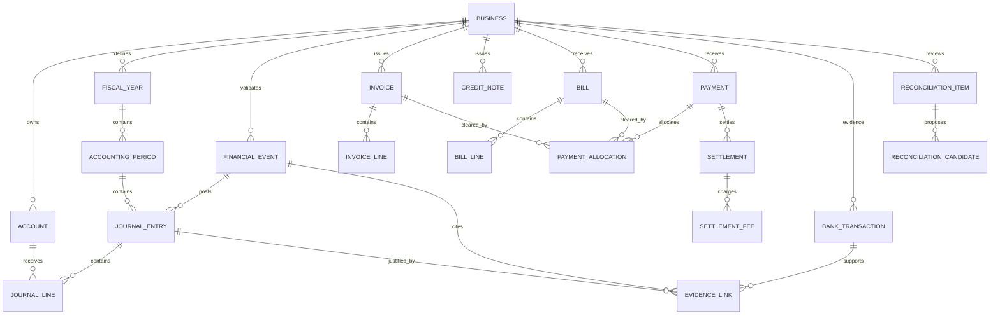

# Financial domain model

Status: **Milestone 2 design; no accounting code or financial table exists.** This
document defines the shared financial model for creators and SMEs. Enforcement is
specified in [ACCOUNTING_INVARIANTS.md](ACCOUNTING_INVARIANTS.md); storage in
[D1_FINANCIAL_SCHEMA_DESIGN.md](D1_FINANCIAL_SCHEMA_DESIGN.md); payment flows in
[PAYMENT_AND_SETTLEMENT_LIFECYCLE.md](PAYMENT_AND_SETTLEMENT_LIFECYCLE.md).

The current money primitive (`src/core/money.ts`) is implemented. Nothing else in
this document is.

---

## 1. Books are configured once per business

A `Business` owns exactly one set of books. The following are explicit, audited
configuration, not inferred from the customer segment:

| Setting | Values | Rule |
| --- | --- | --- |
| Functional currency | ISO 4217 code supported by `CURRENCIES` | Immutable once a posted entry exists. |
| Accounting basis | `accrual` or `cash` | Immutable once a posted entry exists; a policy change is prospective and versioned. |
| Fiscal year | start month/day, timezone-independent dates | Periods generated from it; changing it mid-year requires a controlled close. |
| Chart template | minimal by default | Provisions accounts; users may add accounts within classification rules. |
| Revenue policy | versioned rule reference | Determines when an invoice/payment/statement creates revenue; never an AI choice. |
| Tax configuration | jurisdiction references only | No rate or filing rule is encoded until validated. |

The same journal, receivables, payables, payment and settlement structures serve both
segments. `business_type` changes defaults and optional capabilities, never the
double-entry rules.

---

## 2. Financial object map



`ACCOUNT`, `FISCAL_YEAR`, `ACCOUNTING_PERIOD`, `FINANCIAL_EVENT`, `JOURNAL_ENTRY`,
`JOURNAL_LINE`, `INVOICE`, `CREDIT_NOTE`, `BILL`, `PAYMENT`, `PAYMENT_ALLOCATION`,
`SETTLEMENT`, `SETTLEMENT_FEE`, `BANK_TRANSACTION` and `RECONCILIATION_*` are
proposed. The diagram is a design target.

---

## 3. Accounting foundation

### 3.1 Account

`Account { accountId, businessId, code, name, classification, normalBalance, parentAccountId?, isPostable, status }`

- Classification: `asset`, `liability`, `equity`, `revenue`, `expense`.
- Normal balance is derived from classification (asset/expense debit; liability/
  equity/revenue credit) and stored for reporting clarity, but cannot contradict the
  classification.
- Codes are unique per business. A parent may be non-postable; only postable leaf
  accounts receive journal lines.
- Classification is immutable after the account has a posted line. Deactivate,
  never delete.
- Accounts are always in the business's functional currency. Foreign-currency
  amounts are translated on the line; do not create a separate account per currency.

### 3.2 Fiscal year and accounting period

`FiscalYear { id, businessId, startDate, endDate, status }`
`AccountingPeriod { id, businessId, fiscalYearId, startDate, endDate, status }`

States: `open → locked → closed`. A locked period rejects new postings but remains
visible; closing freezes reported comparatives. Reopening is a privileged, audited
transition with a reason. Periods may not overlap for the same business. Every posted
entry belongs to exactly one period and its `entryDate` must fall inside it.

### 3.3 Financial event

`FinancialEvent { id, businessId, type, occurredAt, sourceType, sourceKey, idempotencyKey, interpretationVersion, status }`

Types are deliberately few and stable: `invoice.issued`, `credit_note.issued`,
`payment.received`, `payment.refunded`, `chargeback.received`, `fee.charged`,
`bill.received`, `bill.paid`, `inventory.cost_recognised`, `adjustment.recorded`,
`opening_balance.recorded`, `reversal.recorded`.

The event is the validated bridge between evidence/operations and the journal. It
carries provenance references and the rule version used. A source record may produce
at most one event of a given type for its idempotency key.

### 3.4 Journal entry and line

`JournalEntry { id, businessId, periodId, entryDate, postedAt, description, sourceEventId?, reversalOfEntryId?, status, createdBy, postedBy, ruleVersion }`

`JournalLine { id, businessId, entryId, lineNo, accountId, direction, amountMinor, transactionCurrency?, transactionAmountMinor?, fxRate?, fxRateDate?, fxRateSource?, dimensions[] }`

- `status ∈ {draft, posted}`. Only `posted` affects balances. `reversed` is derived
  from a posted reversal entry; the original row is never edited.
- Line amount is a positive integer in the **functional currency**; `direction`
  (`debit`/`credit`) carries the sign. A negative amount is invalid.
- Foreign-currency lines additionally retain the original transaction amount,
  currency, rate, rate date and source. Translation is evidence; the functional
  amount is the accounting fact.
- A posted entry is append-only. Correction is a reversal entry linked by
  `reversalOfEntryId`, followed by a new entry. No update or delete path exists.
- Every entry has provenance: a `sourceEventId`, or an `adjustment` event with an
  explicit reason and actor.
- At least two lines, at least two distinct accounts, each amount > 0, debits equal
  credits exactly, all in the same functional currency.

Journal lines are the only authoritative balance source. A cached balance table is a
performance optimisation that must be rebuildable and must never override the
journal.

### 3.5 Opening and closing balances

- Opening balances are a posted journal entry with `sourceType='opening_balance'` and
  an evidence/approval reference. There is no mutable `opening_balance` column.
- Closing balance = sum of posted lines through the period end. Closing an account
  or period never writes a balancing plug; retained earnings is a posted closing
  entry only if the chosen accounting policy requires it.
- Comparative figures are derived and labelled with the policy/version that produced
  them.

---

## 4. Revenue, receivables and documents

### 4.1 Revenue source (classification, not a ledger)

`RevenueSource` is a dimension on invoice lines, financial events and reporting:
`platform`, `sponsorship`, `campaign`, `affiliate`, `subscription`, `product`,
`service`, `retainer`, `other`.

It answers "what kind of commercial activity earned this?" without creating a second
chart of accounts. Revenue accounts remain standard; the dimension supports creator
and SME reporting.

### 4.2 Invoice and credit note

A **sales transaction** is the commercial umbrella for a sale, not a third ledger
object. It may consist of an optional sales order (commitment), the issued invoice
(the receivable/revenue document) and the payment(s) that clear it. Do not post the
order and the invoice as separate revenue facts.

`Invoice { id, businessId, number, partyId, issueDate, dueDate, currency, status, subtotalMinor, taxMinor, totalMinor, amountPaidMinor, amountDueMinor, agreementId?, channelId? }`

Lines: description, catalog item reference (optional), quantity, unit price, tax
code/reference, revenue source, account. Derived totals are recomputed and checked;
they are not trusted input.

Status: `draft → issued → partially_paid → paid`; `void` only from draft or an issued
invoice with no allocations; `overdue` is a derived flag, not a stored state.

Invariants: number unique per business; issued invoices are immutable except through
credit notes; allocations cannot exceed total; tax totals must reconcile to line tax
components. Credit notes reverse all or part of an invoice and carry their own
number and reason.

### 4.3 Receivable and payable are derived

There is no editable `receivable` balance. A receivable is:

```
invoice.totalMinor − credit notes − active allocations − write-offs
```

A payable is the analogous derivation for a vendor bill. Storing these as mutable
rows invites drift and lost updates. A reporting projection may cache them, keyed by
business and rebuilt from source documents.

### 4.4 Expense, vendor bill and purchase

- An **expense** is a financial event/line for a cost. It may be backed by a bill, a
  receipt, a bank transaction or an explicit manual justification.
- A **vendor bill** is a financial document with lines, due date, tax and payable.
- A **purchase order** is an operational commitment. Receiving goods/services can
  create a bill or inventory movement; a PO alone is not a liability.
- **Expense category** is a reporting/account mapping, not a separate ledger.
- Contractor compensation and employee obligations become financial events only when
  approved under a documented policy. Payroll and withholding are out of scope.

---

## 5. Payments and settlement

The full lifecycle is in
[PAYMENT_AND_SETTLEMENT_LIFECYCLE.md](PAYMENT_AND_SETTLEMENT_LIFECYCLE.md). The
domain separation is mandatory:

| Concept | What it means | Accounting effect |
| --- | --- | --- |
| Payment intent / authorization | Provider approval to charge; no money moved | None |
| Capture | Provider confirms the charge; funds are due from provider | Clearing asset; reduce receivable only through allocation |
| Payment | Customer cash receipt recorded by Hestian | Allocatable amount and clearing/asset movement |
| Settlement | Provider pays net funds to the bank | Bank + fee + clearing movement |
| Bank transaction | Statement evidence of money at the bank | Evidence, not authority |
| Allocation | Application of a payment to an invoice/bill | Clears receivable/payable |
| Refund | Return of captured funds | Reverse allocation/clearing; refund liability/expense per policy |
| Dispute / chargeback | Contested or reversed capture | Conditional receivable/liability and fee; explicit state |

A payment may be allocated to several invoices; an invoice may receive several
payments. Unallocated money is a customer credit (liability), never revenue.
Allocations are immutable; correction is a reversal allocation.

---

## 6. Data dictionary (proposed)

| Object | Key fields | Rules |
| --- | --- | --- |
| Account | `id`, `business_id`, `code`, `classification`, `normal_balance`, `parent_id`, `is_postable`, `status` | Code unique per business; no posting to parent/inactive |
| FiscalYear | `id`, `business_id`, `start_date`, `end_date`, `status` | Periods contained; no overlap |
| AccountingPeriod | `id`, `business_id`, `fiscal_year_id`, `start_date`, `end_date`, `status` | `open/locked/closed`; entry date must fall inside |
| FinancialEvent | `id`, `business_id`, `type`, `occurred_at`, `source_type`, `source_key`, `idempotency_key`, `rule_version`, `status` | Source key unique per business; provenance |
| JournalEntry | `id`, `business_id`, `period_id`, `entry_date`, `status`, `source_event_id?`, `adjustment_reason?`, `reversal_of_entry_id?`, `idempotency_key`, `posted_at` | `draft/posted`; posted immutable |
| JournalLine | `id`, `business_id`, `entry_id`, `line_no`, `account_id`, `direction`, `amount_minor`, `currency`, `transaction_currency?`, `fx_rate?` | Positive amount; exact balance; no update after posting |
| Invoice | `id`, `business_id`, `number`, `party_id`, `issue_date`, `due_date`, `currency`, `status`, `total_minor`, `amount_paid_minor` | Issued immutable; allocations bounded |
| CreditNote | `id`, `business_id`, `invoice_id`, `number`, `amount_minor`, `reason`, `status` | Cannot exceed invoice/remaining |
| Bill | `id`, `business_id`, `number`, `party_id`, `issue_date`, `due_date`, `currency`, `status`, `total_minor` | Payable source; no PO authority |
| Payment | `id`, `business_id`, `party_id`, `amount_minor`, `currency`, `captured_at`, `status`, `provider_ref?` | Provider ref unique; captured amount allocatable |
| PaymentAllocation | `id`, `business_id`, `payment_id`, `document_type`, `document_id`, `amount_minor`, `currency`, `status` | Immutable; cumulative limits |
| Settlement | `id`, `business_id`, `payment_id`, `gross_minor`, `fee_minor`, `net_minor`, `status`, `provider_payout_id` | `gross = net + fee`; unique payout |
| Refund / Dispute | `id`, `business_id`, `payment_id`, `amount_minor`, `status`, `reason`, `provider_ref` | Linked to original; cumulative limit |
| EvidenceLink | `business_id`, `evidence_id`, `event_id?`, `journal_entry_id?`, `document_type?`, `document_id?` | Immutable after posting; provenance |

Every table includes `business_id`; every parent exposes a composite unique key for
tenant-safe foreign keys. See the D1 design for column-level DDL.

## 7. What the model deliberately separates

| Must not be conflated | Correct representation |
| --- | --- |
| Revenue recognised vs cash received | Revenue comes from an invoice/event under the accounting basis; cash comes from payment/settlement. |
| Invoice issued vs invoice paid | Invoice creates receivable/revenue; payment allocation clears receivable. |
| Payment captured vs payment settled | Capture creates a clearing asset; settlement moves clearing to bank less fees. |
| Profit vs available cash | Profit is revenue − expenses; cash is bank + clearing − liabilities. |
| Tax reserve vs tax liability | Reserve is an allocation of equity/retained earnings; liability is owed to an authority. |
| Forecast vs confirmed money | Forecasts live in Layer C and cannot be rendered as actuals. |
| Gross platform earnings vs net deposit | Gross revenue and platform fee are separate postings; net deposit is settlement. |

---

## 8. Creator coverage

### Platform earnings

A YouTube/TikTok/AdSense earnings statement is **source evidence**. It declares gross
earnings, platform deductions and net payable. A validated `platform.earnings` event
posts gross revenue, platform fee expense and a clearing receivable. When the platform
deposits net cash, a settlement clears the receivable and records the bank amount.
Do not record the net deposit as revenue; that understates revenue and hides fees.

If a statement only shows a net figure with no fee breakdown, the item remains
unresolved or uses a documented estimated-fee policy; it is never silently assumed.

### Sponsorship, brand deals and campaigns

A sponsorship is a `CommercialAgreement` with a counterparty, deliverables, amount,
currency, billing schedule and recognition conditions. It produces ordinary invoices
and payments, optionally linked to a project/campaign and `sponsorship` revenue
source. A deposit received before delivery is a liability (deferred revenue), not
revenue, until the recognition condition is met.

### Affiliate, subscription and product income

- Affiliate commission statements are evidence; commission revenue and any platform
  fee are separate lines.
- Subscriptions use invoices or recurring contracts; each billing period is an
  ordinary invoice, with `subscription` as the source dimension.
- Digital product sales use the same invoice/payment path; delivery is operational,
  not a second ledger.

### Creator-specific reporting dimensions

`revenue_source`, `channel`, `agreement_id`, `project_id` and `party_id` provide
creator reporting without adding accounting primitives. A sponsorship is not a
journal entry type; it is an agreement that produces invoices/events.

Revenue-sharing arrangements use the same agreement/event path: the share is a
contractual split of gross revenue or a fee, recorded as explicit revenue and
expense/liability lines. Do not invent a separate "creator split" ledger primitive.

---

## 9. SME coverage

- **Sales order → invoice → payment → settlement.** The order is operational; the
  invoice is the receivable; payment allocation clears it; settlement handles provider
  fees and bank cash.
- **Purchase order → bill → payment.** Receipt of goods/services may create a bill
  and inventory movement. A PO is not a payable.
- **Inventory and COGS.** Inventory movements are operational records. COGS is
  recognised by a documented valuation policy (deferred) and becomes a financial
  event. Until that policy exists, inventory value is not an accounting balance.
- **Customer and vendor credit.** Credit notes/credit balances are explicit
  liabilities/assets, not negative invoices.
- **Channels and locations.** Dimensions for reporting and reconciliation; each
  channel may have its own provider connection and settlement schedule.
- **Operating expenses and recurring contracts.** Expenses are events; recurring
  contracts generate ordinary invoices; no automatic posting without a rule version.
- **Service delivery.** A service engagement/project may track time and milestones
  operationally; the invoice or milestone event is the accounting fact. Delivering a
  service does not itself create a journal line until the recognition rule fires.

---

## 10. Money, currency and precision

Preserve `src/core/money.ts`: integer minor units, `bigint` in memory, decimal strings
on the wire, range ±(2^53−1), no binary floating point.

Design rules:

- **Currency is explicit on every amount.** A missing currency is an error, not a
  default.
- **Currency exponent is currency-specific.** `CURRENCIES` currently covers a small
  reviewed set (USD, EUR, GBP, CAD, AUD, NZD, SGD with 2 digits; JPY/KRW with 0; KWD
  with 3). **INR is not currently supported**; adding it (2 digits) is a reviewed
  change before the ₹ examples in the payment document can be implemented.
- **Multiplication/division** by a fractional factor requires an explicit rounding
  policy. Until then, only whole-number scaling is available.
- **Allocation** uses largest-remainder or a documented deterministic rule; the sum
  of allocated minor units must equal the allocated total exactly. No per-line
  floating-point rounding.
- **Tax** calculations are rule-versioned and use integer arithmetic with a stated
  rounding boundary (per line vs per document), validated with a tax professional.
- **FX** stores transaction currency/amount, functional amount, rate, rate date and
  source. Realised and unrealised treatment is a policy decision; no implied rate.
- **Rounding modes** are explicit per operation (`half-up`, `half-even`, etc.) and
  never a global guess. The policy is part of the rule version.
- **Serialization** is a decimal string for minor units; database storage is
  `INTEGER` within the safe range. D1 `bigint` binding behaviour is still unverified.

---

## 11. Representative end-to-end flows

### Creator sponsorship

```
Agreement ₹200,000, 50% on signature, 50% on delivery
  → invoice 1 ₹100,000 (issued)        Dr receivable / Cr deferred or revenue per policy
  → payment ₹100,000 captured          Dr clearing / Cr receivable (allocation)
  → settlement ₹98,500, fee ₹1,500     Dr bank 98,500 + fee 1,500 / Cr clearing 100,000
  → delivery completed                 recognise remaining revenue per policy
```

The invoice, payment, settlement and revenue recognition are distinct facts.

### SME sale with gateway

```
Invoice ₹50,000 (issued)               Dr receivable 50,000 / Cr revenue 50,000
Capture ₹50,000                        Dr clearing 50,000 / Cr receivable 50,000
Settlement ₹49,000, fee ₹1,000         Dr bank 49,000 + fee 1,000 / Cr clearing 50,000
```

No revenue is posted at capture or settlement. The fee is an expense, not a reduction
of revenue unless the chosen policy explicitly treats it as a deduction.

### Platform earnings

```
Statement gross ₹80,000, platform fee ₹16,000, net ₹64,000
  → revenue 80,000 / fee 16,000 / clearing 64,000
  → bank deposit 64,000 clears the clearing account
```

---

## 12. Deferred financial decisions

- Journal-level vs line-level tax and rounding.
- Revenue recognition standards (IFRS 15/ASC 606/local rules); no standard is
  asserted.
- Inventory valuation and COGS method.
- FX rate source, revaluation frequency and realised/unrealised policy.
- Bad debt, write-off, dispute and chargeback policy details.
- Intercompany/consolidation, owner draws, payroll and withholding.
- Whether account balances are always derived or materialised per period.
- Retention periods for financial records. No period is invented here.
