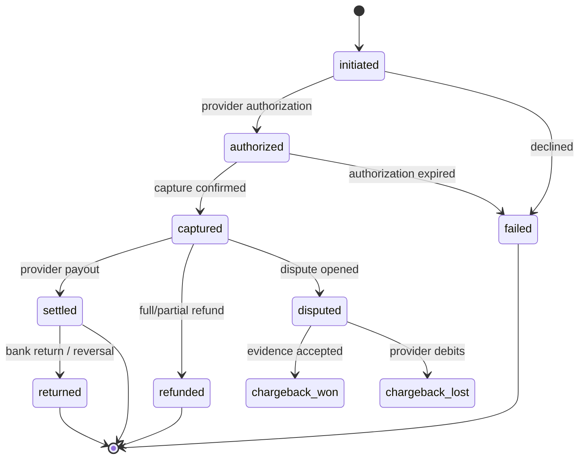

# Payment and settlement lifecycle

Status: **design only. No payment provider integration, payment execution, capture,
settlement or reconciliation code exists.** This document defines the states and
accounting consequences the financial core must implement. No live provider is called
by Hestian today.

Currency note: the examples use ₹ for readability, but **INR is not currently in
`src/core/money.ts`'s currency registry**. Adding INR (2 minor digits) is a reviewed
change required before these examples can be represented in code.

---

## 1. The central distinction

A customer payment passes through up to four separate facts:

```
authorization  →  capture  →  payment record  →  settlement  →  bank statement
(no money)        (provider    (Hestian's       (provider      (external evidence)
                   owes funds)  cash receipt)    pays net)
```

They are related but not interchangeable. Collapsing capture and settlement into one
"payment received" row is the most common source of double-counted revenue and
invisible gateway fees.

| Fact | Who asserts it | Accounting authority? |
| --- | --- | --- |
| Authorization | Payment provider | No |
| Capture | Provider webhook/API, verified | Creates a financial event after validation |
| Payment | Hestian financial core | Yes, once posted |
| Settlement | Provider payout record + bank evidence | Yes, once posted |
| Bank transaction | Bank statement/provider export | Evidence only until reconciled |

---

## 2. Objects

| Object | Purpose | Key fields |
| --- | --- | --- |
| `PaymentIntent` | Provider authorization reference; no accounting effect | provider, providerIntentId, amount, currency, status, businessId |
| `Payment` | Customer cash receipt/allocatable amount | id, businessId, partyId, direction, amountMinor, currency, capturedAt, status, providerRef, paymentIntentId? |
| `PaymentAllocation` | Applies a payment to an invoice/bill | id, businessId, paymentId, documentType, documentId, amountMinor, currency, status, reversedBy? |
| `Settlement` | Provider payout to bank | id, businessId, paymentId, provider, grossMinor, feeMinor, netMinor, expectedAt, settledAt, status, providerPayoutId |
| `SettlementFee` | Itemised provider fee | settlementId, type, amountMinor, taxMinor? |
| `Refund` | Return of captured funds | id, businessId, paymentId, amountMinor, reason, status, providerRef |
| `Dispute` / `Chargeback` | Contested/reversed capture | id, businessId, paymentId, amountMinor, state, deadline, evidenceRefs |
| `BankTransaction` | Statement line | id, businessId, bankAccountRef, amountMinor, currency, valueDate, reference, evidenceId |
| `CustomerCredit` | Unallocated payment remainder | derived from payment − active allocations; not a mutable balance |

All are tenant-owned. A payment, settlement and bank transaction may belong to
different providers and dates; links are explicit.

---

## 3. Payment lifecycle



These states describe the **provider/cash** object. The invoice remains
`issued/partially_paid/paid` independently. A payment can be `captured` while the
invoice is still unpaid if no allocation exists.

### 3.1 Capture

Capture is the first accounting-relevant provider event. On capture:

```
Dr  Clearing account (provider receivable)   gross
Cr  Accounts receivable / Customer credit    gross
```

The credit is to AR only through an allocation. Without an allocation, the credit is
customer credit (a liability), never revenue. Revenue was already recognised when the
invoice was issued under accrual accounting; capture does not create revenue again.

### 3.2 Payment record

Hestian records a `Payment` at capture (or when a manual bank transfer is confirmed).
It carries the amount that can be allocated. A payment is not a settlement; it does
not mean the bank has the money.

### 3.3 Allocation

```
Dr  Accounts receivable (or customer credit)  amount
Cr  Clearing / cash                            amount
```

Allocation is immutable once posted. It may be split across several invoices; an
invoice may receive several payments. The sum of active allocations cannot exceed the
payment's allocatable amount or the invoice's outstanding amount. Reversal creates a
reversal allocation, not an edit.

### 3.4 Settlement

When the provider pays out:

```
Dr  Bank account                  net
Dr  Gateway fee expense           fee
Cr  Clearing account              gross
```

If the fee is charged separately or taxed, itemise it; never net it silently into
revenue. The settlement record must satisfy `gross = net + fee`. The clearing account
should reach zero for that payment; a residual is a discrepancy item.

### 3.5 Refund

A refund is a new financial fact linked to the original payment. A representative
policy (the exact revenue/contra-revenue treatment is a policy decision):

```
Dr  Sales returns / refunds (contra revenue)   amount
Cr  Clearing / bank                            amount
```

The original payment is not edited. If the refund reverses an allocation, use an
explicit allocation reversal. Refunds cannot exceed the captured amount less previous
refunds. Fees may or may not be returned by the provider; that is a separate fee
adjustment.

### 3.6 Dispute and chargeback

A dispute is a conditional state with a deadline. A lost chargeback is a provider
debit plus a fee; it may reverse revenue only under a documented policy. Both must
link to the original payment and carry provider evidence. A chargeback is not a
negative payment row.

### 3.7 Bank return / failed settlement

If the provider reports a settlement that the bank returns, the bank credit is
reversed and the clearing/provider receivable is reinstated. The cash fact and the
settlement status change independently; never delete the original settlement.

---

## 4. Worked example: ₹50,000 capture, ₹1,000 fee, ₹49,000 net

Assume an accrual-basis invoice already issued for ₹50,000 (INR enabled):

| Step | Entry | Debit | Credit |
| --- | --- | --- | --- |
| 1. Invoice issued | Dr AR / Cr Revenue | 50,000 | 50,000 |
| 2. Capture | Dr Clearing / Cr AR (allocation) | 50,000 | 50,000 |
| 3. Settlement | Dr Bank 49,000; Dr Gateway fee 1,000; Cr Clearing | 50,000 | 50,000 |

Totals: revenue 50,000 (step 1 only), cash 49,000, fee expense 1,000, clearing 0,
AR 0. No revenue is posted at steps 2 or 3. If no allocation existed at capture,
step 2 credits customer credit instead of AR; the invoice remains outstanding.

### 4.1 Delayed settlement

Between capture and settlement the clearing account holds 50,000. That is an asset
("funds due from provider"), not available cash. Reports must label it separately
from bank cash.

### 4.2 Partial settlement

If the provider settles 30,000 with a 600 fee, clearing retains 20,000 and the
settlement is partial. A second settlement or a discrepancy item explains the
remainder. Never mark the payment fully settled.

### 4.3 Failed settlement

If the payout fails, no bank debit is posted; clearing remains. The settlement is
`failed`; a retry is a new attempt linked to the same settlement, not a duplicate
payment. If the provider has already debited the customer, the money is still owed by
the provider.

### 4.4 One invoice, several payments

Invoice 100,000; payment A 40,000, payment B 60,000. Each capture allocates its own
amount; AR clears progressively. Each settlement is independent; fees are attributed
to their payment.

### 4.5 One payment, several invoices

Payment 100,000 allocates 60,000 to invoice 1 and 40,000 to invoice 2 in one batch
(or separate allocations). The payment's unallocated balance is zero. If only 80,000
is allocated, 20,000 remains customer credit; it is never revenue.

### 4.6 Overpayment

Customer pays 110,000 against a 100,000 invoice. Allocation is capped at 100,000;
10,000 is customer credit (liability). A later invoice may consume it through a new
allocation. Do not credit revenue for the excess.

### 4.7 Duplicate webhooks

The provider event id is unique per business/provider. A duplicate delivery finds the
existing financial event and returns its result; it does not capture or post twice.
If two deliveries race, the unique event key aborts one batch; the loser re-reads and
returns the winner's result.

### 4.8 Reversed payment

A provider reversal (not a refund) restores the customer receivable/credit and
reverses the clearing movement. It is a new reversal event linked to the payment.
The payment status becomes `returned`/`reversed`; the original entry stays.

### 4.9 Chargeback

A chargeback debits the bank/provider and usually adds a fee. Post the loss/fee and
any revenue reversal as separate lines, with the dispute evidence link. Do not net
the chargeback against unrelated revenue.

### 4.10 Foreign-currency settlement

Customer pays USD 1,000 into a USD clearing account, but the business's functional
currency is EUR. The payment/line stores USD amount, EUR functional amount, rate,
rate date and source. Settlement in USD is translated at its own date; the difference
is realised FX gain/loss. Never translate with a rate inferred at report time.

---

## 5. Settlement discrepancies

| Situation | Representation | Resolution |
| --- | --- | --- |
| Fee differs from expectation | Settlement with itemised `SettlementFee`; clearing residual | Investigate fee schedule; adjust fee line, never revenue silently |
| Net amount short | Partial settlement; `settlement_discrepancy` item | Second payout or provider claim |
| Net amount over | Unexplained credit; do not post revenue | Link to provider adjustment/evidence |
| Duplicate payout | Duplicate provider payout id rejected/linked | Return or apply to future settlement with audit |
| Bank reference mismatch | Bank transaction unmatched | Manual review; no automatic clearance |
| FX rate differs | Realised FX line | Rate provenance and policy |

A discrepancy is a first-class unresolved item. It is not a rounding plug.

---

## 6. Invariants exercised by this lifecycle

FI-04 (idempotency), FI-09 (allocation limits), FI-10 (separation), FI-25
(settlement identity), FI-28 (refund/chargeback limits), FI-32 (FX provenance),
FI-34 (tenant references). See [ACCOUNTING_INVARIANTS.md](ACCOUNTING_INVARIANTS.md).

---

## 7. Explicitly not implemented

- Provider OAuth, webhook intake, signature verification and payout APIs.
- Payment execution, refunds or capture calls.
- Bank feed ingestion and statement parsing.
- Live FX rates.
- Dunning, retries and payment method storage.
- Tax treatment of fees and refunds.
- Any claim that the worked example is compliant with a tax or accounting standard.
